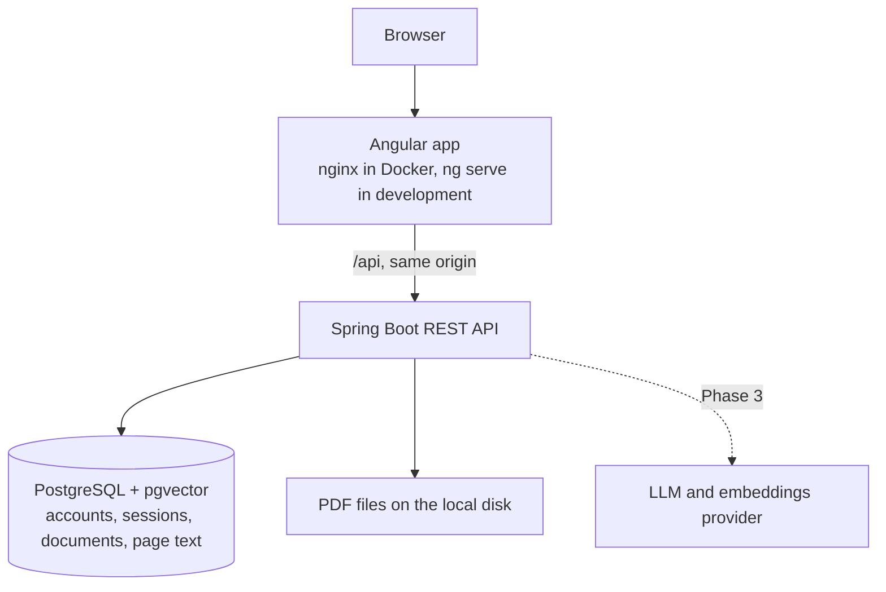

# DocChat AI

DocChat AI is a full-stack platform, under construction, for asking questions about PDF documents in natural language and getting answers backed by verifiable citations to the source pages. It is built with Java, Spring Boot, RAG (Retrieval-Augmented Generation), PostgreSQL with pgvector, and Angular.

It runs only on your own machine. There is no cloud service and no deployment, and it uses only free software.

> **Current state:** accounts and PDF upload with text extraction work (Phases 1 and 2). Asking questions (RAG and chat) is not implemented yet. See [Project status](#project-status).

## The problem

Finding a specific answer in a long document, such as a 40-page contract, means reading it or searching for exact words. Generic AI chat can answer faster, but its answers are hard to trust without knowing where they came from. DocChat AI is designed to answer only from the user's own documents, cite the pages it used, and say so when the documents do not contain the answer.

## Project status

| Phase | Scope | Status |
|---|---|---|
| 1. Foundation | Backend, frontend, database, migrations, health checks, Docker | Complete |
| 2. Authentication and documents | Accounts, authorization, PDF upload and extraction | Complete |
| 3. RAG | Chunking, embeddings, vector search, LLM answers with citations | Planned |
| 4. Conversations and interface | History, source viewer, complete UI flow | Planned |
| 5. Tests and robustness | End-to-end and security tests, failure recovery | Planned |
| 6. Performance and documentation | Observability, load tests, final documentation | Planned |

**How Phases 1 and 2 were checked:** the automated tests listed under [Tests](#tests), plus runs on the developer's machine of the Compose stack and of the development setup. With the stack running, a stopped database, a stopped backend and a recreated backend were tried by hand. The complete flow (registration, uploads, rejected files, restarts, deletion, signing out, pagination and isolation between users) was run in headless Microsoft Edge with a one-off script that is not part of this repository, so those browser checks are not repeated automatically yet.

## Architecture

The backend is a [modular monolith](docs/adr/0001-modular-monolith.md). The browser only talks to one origin, and the API is proxied behind it. The dashed line is planned.



Backend packages today:

| Package | Responsibility |
|---|---|
| `com.docchat.common` | Correlation ids, Problem Details error format, OpenAPI configuration |
| `com.docchat.system` | Status endpoint and pgvector health indicator |
| `com.docchat.auth` | Accounts, login, sessions, CSRF protection and access rules |
| `com.docchat.document` | Document records, upload rules and ownership |
| `com.docchat.storage` | PDF files on the local disk and the storage health indicator |
| `com.docchat.ingestion` | Background text extraction with a bounded queue |

New modules (`rag`, `chat`, `ai`) are added when they have real code.

An upload is answered right after the file is stored, and the document starts as `PROCESSING`. A small pool of workers then extracts the text of each page into the database and marks the document `READY`, or `FAILED` with a reason. The interface checks every two seconds while a document is processing. Documents interrupted by a shutdown are processed again at the next startup.

## Tech stack

| Technology | Version | Why |
|---|---|---|
| Java | 21 LTS | Required language level. The build also runs on JDK 25. |
| Spring Boot | 4.1.2 | Current supported line. See [ADR 0002](docs/adr/0002-spring-boot-4-and-spring-ai-2.md). |
| Spring Security and Spring Session JDBC | 7.1 and 4.1 (managed by Spring Boot) | Server-side sessions with an HttpOnly cookie. See [ADR 0004](docs/adr/0004-server-side-sessions.md). |
| Spring AI | 2.0.2 (BOM only, used from Phase 3) | Access to LLMs, embeddings and pgvector without tying the code to one provider. |
| PostgreSQL + pgvector | 18 + 0.8.7 | One database for relational data and vectors. See [ADR 0003](docs/adr/0003-pgvector-for-vector-storage.md). |
| Flyway | 12.4.0 (managed by Spring Boot) | Versioned schema migrations. |
| Apache PDFBox | 3.0.8 | Extracts the text of each PDF page. |
| springdoc-openapi | 3.2.0 | OpenAPI document and Swagger UI. |
| Angular | 22.2 | Standalone components, signals and strict TypeScript. |
| Angular Material | 22.2 | Accessible forms, dialogs and pagination. See [ADR 0006](docs/adr/0006-angular-material.md). |
| JUnit, Mockito, Testcontainers, Vitest | Managed by Spring Boot and Angular | Automated tests without paid APIs. |

## Getting started

Copy the example configuration first, then change `POSTGRES_PASSWORD` in `.env`:

```bash
cp .env.example .env
```

### Run everything in Docker

Requires Docker with Compose.

```bash
docker compose up --build
```

Then open <http://localhost:4200>, create an account and upload a PDF. The home page shows the live status of the backend and the database.

### Run for development

Requires JDK 21 or newer, Node.js 26 (or another [version supported by Angular 22](https://angular.dev/reference/versions)) and Docker for the database.

```bash
docker compose up -d db

cd backend
./mvnw spring-boot:run -Dspring-boot.run.profiles=dev

cd frontend
npm ci
npm start
```

Open <http://localhost:4200>. `ng serve` proxies the API to the backend on port 8080. Uploaded files go to `backend/storage`, which Git ignores.

On Windows, use `mvnw.cmd` instead of `./mvnw`. In Windows PowerShell, also quote the property, because PowerShell splits an unquoted argument at the dot and Maven fails with `Unknown lifecycle phase`:

```powershell
.\mvnw.cmd spring-boot:run '-Dspring-boot.run.profiles=dev'
```

### Environment variables

| Variable | Used by | Description |
|---|---|---|
| `POSTGRES_DB` | Compose, `dev` profile | Database name |
| `POSTGRES_USER` | Compose, `dev` profile | Database user |
| `POSTGRES_PASSWORD` | Compose, `dev` profile | Database password, with no default on purpose |
| `POSTGRES_PORT`, `BACKEND_PORT`, `FRONTEND_PORT` | Compose, `dev` profile | Host ports, bound to 127.0.0.1 |
| `DOCCHAT_DB_URL`, `DOCCHAT_DB_USERNAME`, `DOCCHAT_DB_PASSWORD` | `prod` profile | Database connection. Compose sets these for the container. |
| `DOCCHAT_STORAGE_DIR` | Backend | Directory for uploaded files. Compose sets it to a named volume. The default is `storage`, relative to the working directory. |

## API

The API is documented with OpenAPI at `/v3/api-docs`, and Swagger UI is at `/swagger-ui/index.html`.

| Endpoint | Description |
|---|---|
| `POST /api/auth/register` | Creates an account from JSON with `email` and `password`. Passwords need at least 12 characters and at most 72 bytes. |
| `POST /api/auth/login` | Signs in from a form with `email` and `password`. Answers 204 and sets the session cookie. |
| `POST /api/auth/logout` | Ends the session. Answers 204. |
| `GET /api/auth/me` | The signed-in user. Answers 401 when no one is signed in. |
| `POST /api/documents` | Uploads a PDF of up to 25 MB as the multipart part `file`. Answers 202. |
| `GET /api/documents?page=0&size=20` | The user's documents, newest first, with `items`, `page`, `size` and `totalItems`. |
| `GET /api/documents/{id}` | One document, with its `status`, `failureReason` and `pageCount`. |
| `DELETE /api/documents/{id}` | Deletes the document, its text and its file. Answers 204. |
| `GET /api/system/status` | Real state of each dependency. Answers 200 while the backend runs. Public. |
| `GET /actuator/health/readiness` | Readiness probe. Answers 503 if the database, pgvector or the file storage is unavailable. Public. |
| `GET /actuator/health/liveness` | Liveness probe. Public. |

Requests that change data must send the value of the `XSRF-TOKEN` cookie in the `X-XSRF-TOKEN` header. Any response from the backend sets that cookie.

```bash
curl http://localhost:8080/api/system/status
```

```json
{ "status": "UP", "database": "UP", "vectorExtension": "UP" }
```

Errors use [RFC 9457 Problem Details](https://www.rfc-editor.org/rfc/rfc9457) with `code`, `timestamp` and `correlationId` members, plus `errors` when request fields are invalid. Every response has an `X-Correlation-Id` header, and the same id appears in the logs, including those of the document's background processing.

A `FAILED` document has one of these reasons:

| `failureReason` | Meaning |
|---|---|
| `NOT_READABLE` | The file is damaged or is not really a PDF |
| `PROTECTED` | The file needs a password or forbids text extraction |
| `NO_EXTRACTABLE_TEXT` | No page has text, as in a scanned PDF |
| `TOO_MANY_PAGES` | The file has more than 2000 pages |
| `PROCESSING_UNAVAILABLE` | The processing queue was full |
| `INTERNAL_ERROR` | An unexpected failure, recorded in the logs |

## Tests

| Command | Runs | Needs Docker |
|---|---|---|
| `./mvnw test` (in `backend`) | Unit and web tests, including the full application context with an unreachable database | No |
| `./mvnw verify` (in `backend`) | The above, plus integration tests over real HTTP against real PostgreSQL + pgvector | Yes. It fails without Docker. |
| `npm test -- --watch=false` (in `frontend`) | Component and service tests | No |
| `npm run lint` (in `frontend`) | ESLint | No |
| `npm run build` (in `frontend`) | Production build | No |

No test calls a paid API. Test PDFs are generated by the tests themselves.

## Security

This version is meant to run on your own machine and **must not be exposed publicly**, because it does not yet have the protections listed under [Known limitations](#known-limitations). Today:

- Passwords are hashed with BCrypt.
- Sessions live in PostgreSQL behind an HttpOnly, SameSite=Lax cookie, and signing in replaces the session id.
- Requests that change data need a CSRF token.
- Each user reaches only their own documents. Another user's document answers 404, so its existence is not revealed.
- Uploads are checked by their PDF signature and size, and files on disk are named after the document id, never after the name the client sent.
- Compose binds every published port to 127.0.0.1.
- Only the `health` and `info` Actuator endpoints are exposed, and health responses omit component details.
- Error responses never include stack traces or internal messages.
- Secrets come from the environment, and `.env` is ignored by Git.
- The backend and frontend containers run as non-root users.

## Troubleshooting

| Message | Cause | Fix |
|---|---|---|
| `Failed to configure a DataSource: 'url' attribute is not specified` | No Spring profile is active | Run with the `dev` or `prod` profile |
| `'url' must start with "jdbc"` | The `prod` profile is active and `DOCCHAT_DB_URL` is not set | Set the `DOCCHAT_DB_*` variables |
| `password authentication failed` in the `dev` profile | `.env` is missing, or its password differs from the one the database volume was created with | Check `.env` in the repository root. To start over, run `docker compose down -v`, which deletes the database and the uploaded files. |
| `Could not find a valid Docker environment` during `./mvnw verify` | Docker is not running | Start Docker, or use `./mvnw test` |
| `403` with the code `FORBIDDEN` on a request that changes data | The request has no CSRF token | Send the `XSRF-TOKEN` cookie's value in the `X-XSRF-TOKEN` header |

## Known limitations

- Scanned PDFs are refused, because there is no text recognition (OCR).
- There is no email verification, password reset or account deletion.
- Login has no rate limit, and uploads have no per-user quota.
- Processing one PDF has no time limit. The number of workers is limited, so a pathological file can hold a worker but cannot exhaust the server's threads.
- A stored PDF cannot be downloaded or viewed yet (Phase 4).
- Swagger UI's "Try it out" does not send the CSRF token, so only read requests work there.
- The UI has automated component tests but no automated browser tests yet (Phase 5).
- Mockito prints a self-attach warning during backend tests, and PDFBox logs a fallback font warning for PDFs using standard fonts. Neither affects results.

## Architecture decisions

- [ADR 0001: Modular monolith](docs/adr/0001-modular-monolith.md)
- [ADR 0002: Spring Boot 4.1 and Spring AI 2.0](docs/adr/0002-spring-boot-4-and-spring-ai-2.md)
- [ADR 0003: pgvector for vector storage](docs/adr/0003-pgvector-for-vector-storage.md)
- [ADR 0004: Server-side sessions with an HttpOnly cookie](docs/adr/0004-server-side-sessions.md)
- [ADR 0005: PDF files on the local disk](docs/adr/0005-local-file-storage.md)
- [ADR 0006: Angular Material for the interface](docs/adr/0006-angular-material.md)
