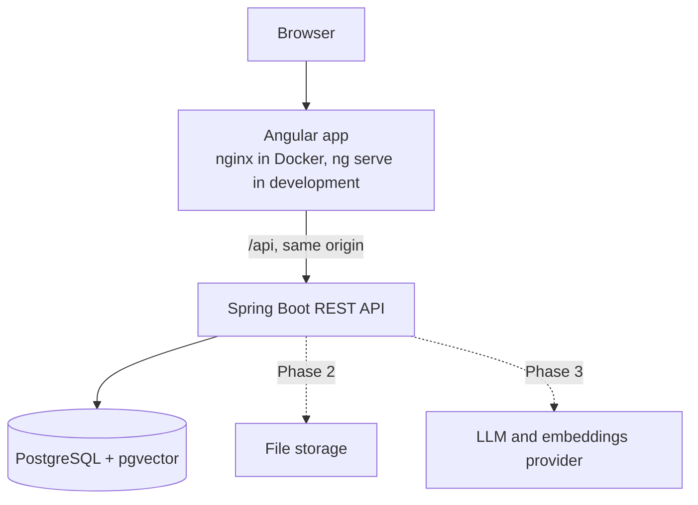

# DocChat AI

DocChat AI is a full-stack platform, under construction, for asking questions about PDF documents in natural language and getting answers backed by verifiable citations to the source pages. It is built with Java, Spring Boot, RAG (Retrieval-Augmented Generation), PostgreSQL with pgvector, and Angular.

> **Current state:** only the project foundation exists (Phase 1, complete). Accounts, document upload, RAG and chat are not implemented yet. See [Project status](#project-status).

## The problem

Finding a specific answer in a long document, such as a 40-page contract, means reading it or searching for exact words. Generic AI chat can answer faster, but its answers are hard to trust without knowing where they came from. DocChat AI is designed to answer only from the user's own documents, cite the pages it used, and say so when the documents do not contain the answer.

## Project status

| Phase | Scope | Status |
|---|---|---|
| 1. Foundation | Backend, frontend, database, migrations, health checks, Docker | Complete |
| 2. Authentication and documents | Accounts, authorization, PDF upload and extraction | Planned |
| 3. RAG | Chunking, embeddings, vector search, LLM answers with citations | Planned |
| 4. Conversations and interface | History, source viewer, complete UI flow | Planned |
| 5. Tests and robustness | End-to-end and security tests, failure recovery | Planned |
| 6. Portfolio and performance | CI/CD, observability, load tests, final documentation | Planned |

**How Phase 1 was checked:** the automated tests, including `FoundationIT` against real PostgreSQL + pgvector, and the Compose stack and the development setup, both run locally. With the stack running, a stopped database, a stopped backend and a recreated backend were each tried by hand. The home page was checked in headless Microsoft Edge. There is no CI yet (Phase 6), so these checks are not repeated automatically.

## Architecture

The backend is a [modular monolith](docs/adr/0001-modular-monolith.md). The browser only talks to one origin, and the API is proxied behind it. Dashed lines are planned.



Backend packages today:

| Package | Responsibility |
|---|---|
| `com.docchat.common` | Correlation ids, Problem Details error format, OpenAPI configuration |
| `com.docchat.system` | Status endpoint and pgvector health indicator |

New modules (`auth`, `document`, `ingestion`, `rag`, `chat`, `ai`, `storage`) are added when they have real code.

## Tech stack

| Technology | Version | Why |
|---|---|---|
| Java | 21 LTS | Required language level. The build also runs on JDK 25. |
| Spring Boot | 4.1.2 | Current supported line. See [ADR 0002](docs/adr/0002-spring-boot-4-and-spring-ai-2.md). |
| Spring AI | 2.0.2 (BOM only, used from Phase 3) | Provider-neutral access to LLMs, embeddings and pgvector. |
| PostgreSQL + pgvector | 18 + 0.8.7 | One database for relational data and vectors. See [ADR 0003](docs/adr/0003-pgvector-for-vector-storage.md). |
| Flyway | 12.4.0 (managed by Spring Boot) | Versioned schema migrations. |
| springdoc-openapi | 3.2.0 | OpenAPI document and Swagger UI. |
| Angular | 22.2 | Standalone components, signals and strict TypeScript. |
| JUnit, Mockito, Testcontainers, Vitest | Managed by Spring Boot and Angular | Automated tests without paid APIs. |

## Getting started

Copy the example configuration first, then change `POSTGRES_PASSWORD` in `.env`:

```bash
cp .env.example .env
```

### Run everything in Docker

Requires Docker with Compose.

```bash
docker compose up --build
```

Then open <http://localhost:4200>. The home page shows the live status of the backend and the database.

### Run for development

Requires JDK 21 or newer, Node.js 26 (or another [version supported by Angular 22](https://angular.dev/reference/versions)) and Docker for the database.

```bash
docker compose up -d db

cd backend
./mvnw spring-boot:run -Dspring-boot.run.profiles=dev

cd frontend
npm ci
npm start
```

Open <http://localhost:4200>. `ng serve` proxies the API to the backend on port 8080.

On Windows, use `mvnw.cmd` instead of `./mvnw`. In Windows PowerShell, also quote the property, because PowerShell splits an unquoted argument at the dot and Maven fails with `Unknown lifecycle phase`:

```powershell
.\mvnw.cmd spring-boot:run '-Dspring-boot.run.profiles=dev'
```

### Environment variables

| Variable | Used by | Description |
|---|---|---|
| `POSTGRES_DB` | Compose, `dev` profile | Database name |
| `POSTGRES_USER` | Compose, `dev` profile | Database user |
| `POSTGRES_PASSWORD` | Compose, `dev` profile | Database password, with no default on purpose |
| `POSTGRES_PORT`, `BACKEND_PORT`, `FRONTEND_PORT` | Compose, `dev` profile | Host ports, bound to 127.0.0.1 |
| `DOCCHAT_DB_URL`, `DOCCHAT_DB_USERNAME`, `DOCCHAT_DB_PASSWORD` | `prod` profile | Database connection. Compose sets these for the container. |

## API

The API is documented with OpenAPI at `/v3/api-docs`, and Swagger UI is at `/swagger-ui/index.html`.

| Endpoint | Description |
|---|---|
| `GET /api/system/status` | Real state of each dependency. Answers 200 while the backend runs. |
| `GET /actuator/health/readiness` | Readiness probe. Answers 503 if the database or pgvector is unavailable. |
| `GET /actuator/health/liveness` | Liveness probe. |

```bash
curl http://localhost:8080/api/system/status
```

```json
{ "status": "UP", "database": "UP", "vectorExtension": "UP" }
```

Errors use [RFC 9457 Problem Details](https://www.rfc-editor.org/rfc/rfc9457) with `code`, `timestamp` and `correlationId` members. Every response has an `X-Correlation-Id` header, and the same id appears in the logs.

## Tests

| Command | Runs | Needs Docker |
|---|---|---|
| `./mvnw test` (in `backend`) | Unit and web tests, including the full application context with an unreachable database | No |
| `./mvnw verify` (in `backend`) | The above, plus integration tests against real PostgreSQL + pgvector | Yes. It fails without Docker. |
| `npm test -- --watch=false` (in `frontend`) | Component and service tests | No |
| `npm run lint` (in `frontend`) | ESLint | No |
| `npm run build` (in `frontend`) | Production build | No |

No test calls a paid API.

## Security

Authentication arrives in Phase 2, so **this version must not be exposed publicly**. Today:

- Compose binds every published port to 127.0.0.1.
- Only the `health` and `info` Actuator endpoints are exposed, and health responses omit component details.
- Error responses never include stack traces or internal messages.
- Secrets come from the environment, and `.env` is ignored by Git.
- The backend and frontend images are configured to run as non-root users.

## Troubleshooting

| Message | Cause | Fix |
|---|---|---|
| `Failed to configure a DataSource: 'url' attribute is not specified` | No Spring profile is active | Run with the `dev` or `prod` profile |
| `'url' must start with "jdbc"` | The `prod` profile is active and `DOCCHAT_DB_URL` is not set | Set the `DOCCHAT_DB_*` variables |
| `password authentication failed` in the `dev` profile | `.env` is missing, or its password differs from the one the database volume was created with | Check `.env` in the repository root. To recreate an empty database, run `docker compose down -v`, which deletes its data. |
| `Could not find a valid Docker environment` during `./mvnw verify` | Docker is not running | Start Docker, or use `./mvnw test` |

## Known limitations

- The UI has automated component tests and has been checked in headless Microsoft Edge only.
- Mockito prints a self-attach warning during backend tests. It does not affect results on Java 21 or 25.

## Architecture decisions

- [ADR 0001: Modular monolith](docs/adr/0001-modular-monolith.md)
- [ADR 0002: Spring Boot 4.1 and Spring AI 2.0](docs/adr/0002-spring-boot-4-and-spring-ai-2.md)
- [ADR 0003: pgvector for vector storage](docs/adr/0003-pgvector-for-vector-storage.md)
