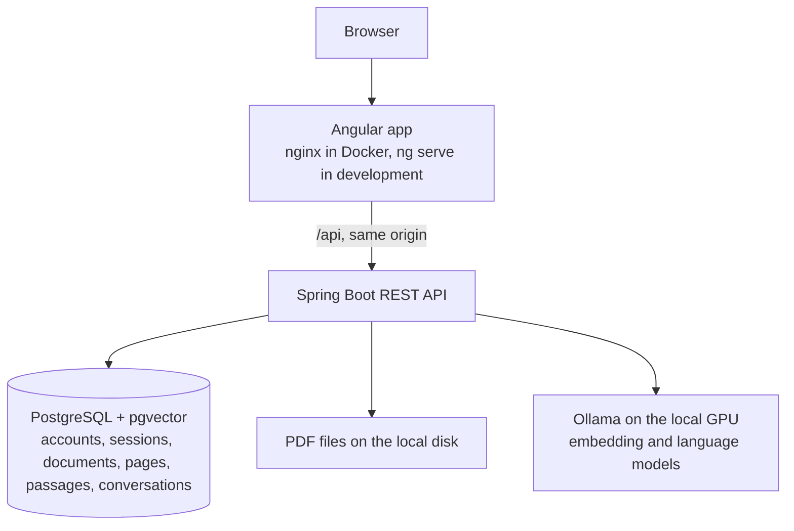

# DocChat AI

DocChat AI is a full-stack platform, under construction, for asking questions about PDF documents in natural language and getting answers backed by verifiable citations to the source pages. It is built with Java, Spring Boot, RAG (Retrieval-Augmented Generation), PostgreSQL with pgvector, Angular and local AI models.

It runs only on your own machine. Your documents never leave it: there is no cloud service and no deployment, and it uses only free software.

> **Current state:** accounts, PDF upload, conversations with cited answers and a viewer for the source pages work, with automated browser and security tests and recovery from failures (Phases 1 to 5). Observability and load tests are not implemented yet. See [Project status](#project-status).

## The problem

Finding a specific answer in a long document, such as a 40-page contract, means reading it or searching for exact words. Generic AI chat can answer faster, but its answers are hard to trust without knowing where they came from. DocChat AI answers only from the user's own documents, cites the pages it used, and says so when the documents do not contain the answer.

## Project status

| Phase | Scope | Status |
|---|---|---|
| 1. Foundation | Backend, frontend, database, migrations, health checks, Docker | Complete |
| 2. Authentication and documents | Accounts, authorization, PDF upload and extraction | Complete |
| 3. RAG | Chunking, embeddings, vector search, LLM answers with citations | Complete |
| 4. Conversations and interface | History, source viewer, complete UI flow | Complete |
| 5. Tests and robustness | End-to-end and security tests, failure recovery | Complete |
| 6. Performance and documentation | Observability, load tests, final documentation | Planned |

**How Phases 1 to 5 were checked:** the automated tests listed under [Tests](#tests), which include the complete flow in a real browser, stopping the database, the backend and the AI service, and restarting the backend during processing. They run in headless Microsoft Edge on the developer's machine, and nothing runs them automatically on a server. Separate commands run the same browser against the real models. A PDF of 500 pages with the real models, opening the original PDF at the cited page, and upgrading a database that already had documents were each checked once by hand and are not repeated automatically. The quality of answers was measured on a few short documents written for the tests, not on real ones.

## Architecture

The backend is a [modular monolith](docs/adr/0001-modular-monolith.md). The browser only talks to one origin, and the API is proxied behind it.



Backend packages today:

| Package | Responsibility |
|---|---|
| `com.docchat.common` | Correlation ids, Problem Details error format, OpenAPI configuration |
| `com.docchat.system` | Status endpoint and pgvector health indicator |
| `com.docchat.auth` | Accounts, login, sessions, CSRF protection and access rules |
| `com.docchat.document` | Document records, upload rules and ownership |
| `com.docchat.storage` | PDF files on the local disk and the storage health indicator |
| `com.docchat.ingestion` | Background text extraction, splitting and embedding, with a bounded queue |
| `com.docchat.ai` | Access to the local models and their availability |
| `com.docchat.rag` | Passage search, rewriting of follow-up questions, the prompts, and answers with verified citations |
| `com.docchat.chat` | Conversations: storing questions, answers and citations, and their ownership |

**Processing a document.** An upload is answered right after the file is stored, and the document starts as `PROCESSING`. A small pool of workers extracts the text of each page, splits it into overlapping passages that never cross a page, embeds them and saves everything in one transaction. The document then becomes `READY`, or `FAILED` with a reason. The interface checks every two seconds while a document is processing.

A document does not stay in `PROCESSING` forever. One that takes longer than the time limit fails with that reason. A shutdown or a database outage says nothing about the document, so it stays as it was, and a check at startup and every minute finds the documents no worker has and processes them again. A document that failed for a reason unrelated to its file, such as the AI service being down, can be tried again from the list without uploading it again.

**Answering a question.**

1. In a conversation with earlier turns, the language model first rewrites the question so that it stands alone, and "and the penalty?" becomes "what is the penalty of the contract?". The interface shows this as "Searched for".
2. The question is embedded, and the closest passages among the user's own `READY` documents are found. Those too different from the question are dropped. If none remains, the answer is "not found" and the language model is not asked to answer.
3. The language model receives the passages, numbered, and must answer only from them, citing their numbers. It never sees file names or page numbers.
4. The server checks the reply. Citations of passages the model was not given are removed, and a reply with no valid citation counts as "not found". Each remaining number becomes the real file and page, which is how citations stay truthful.
5. The question and its answer are stored together. If the model failed, nothing is stored and the question goes back to the input.

**Checking a source.** Each citation opens the text of its page, with the cited passage marked, and from there the original PDF at that page. See [ADR 0008](docs/adr/0008-conversations-and-follow-up-questions.md).

## Tech stack

| Technology | Version | Why |
|---|---|---|
| Java | 21 LTS | Required language level. The build also runs on JDK 25. |
| Spring Boot | 4.1.2 | Current supported line. See [ADR 0002](docs/adr/0002-spring-boot-4-and-spring-ai-2.md). |
| Spring Security and Spring Session JDBC | 7.1 and 4.1 (managed by Spring Boot) | Server-side sessions with an HttpOnly cookie. See [ADR 0004](docs/adr/0004-server-side-sessions.md). |
| Spring AI | 2.0.2 | Access to the models without tying the code to one provider. |
| Ollama | 0.40.14 | Runs open models on the local GPU, with no account or cost. See [ADR 0007](docs/adr/0007-local-ai-with-ollama.md). |
| `bge-m3`, `qwen3.5:9b` | Set by environment variables | Multilingual embeddings and answers, chosen by measuring them on an RTX 3060. |
| PostgreSQL + pgvector | 18 + 0.8.7 | One database for relational data and vectors. See [ADR 0003](docs/adr/0003-pgvector-for-vector-storage.md). |
| Flyway | 12.4.0 (managed by Spring Boot) | Versioned schema migrations. |
| Apache PDFBox | 3.0.8 | Extracts the text of each PDF page. |
| springdoc-openapi | 3.2.0 | OpenAPI document and Swagger UI. |
| Angular | 22.2 | Standalone components, signals and strict TypeScript. |
| Angular Material | 22.2 | Accessible forms, dialogs and pagination. See [ADR 0006](docs/adr/0006-angular-material.md). |
| JUnit, Mockito, Testcontainers, Vitest | Managed by Spring Boot and Angular | Automated tests with no paid APIs, models or GPU. |

## Getting started

Requires Docker with Compose and an NVIDIA GPU that Docker can reach. The models use about 6 GB of GPU memory.

Copy the example configuration first, then change `POSTGRES_PASSWORD` in `.env`:

```bash
cp .env.example .env
```

### Run everything in Docker

```bash
docker compose up --build
```

The first run downloads about 8 GB of models, and the backend starts after that. Then open <http://localhost:4200>, create an account, upload a PDF and ask about it. The home page shows the live status of the backend, the database and the AI models.

### Run for development

Also requires JDK 21 or newer and Node.js 26 (or another [version supported by Angular 22](https://angular.dev/reference/versions)).

```bash
docker compose up -d db ollama ollama-models

cd backend
./mvnw spring-boot:run -Dspring-boot.run.profiles=dev

cd frontend
npm ci
npm start
```

Open <http://localhost:4200>. `ng serve` proxies the API to the backend on port 8080. Uploaded files go to `backend/storage`, which Git ignores.

On Windows, use `mvnw.cmd` instead of `./mvnw`. In Windows PowerShell, also quote the property, because PowerShell splits an unquoted argument at the dot and Maven fails with `Unknown lifecycle phase`:

```powershell
.\mvnw.cmd spring-boot:run '-Dspring-boot.run.profiles=dev'
```

### What to expect from the hardware

Measured on an RTX 3060 with 12 GB and 16 GB of RAM, with the whole stack and desktop applications running:

| Measure | Result |
|---|---|
| Layers on the GPU | 100% of both models |
| Peak GPU memory | About 8.7 GB of 12 GB, including what the desktop uses |
| Typical answer | 1 to 3 seconds, and follow-up questions take about the same |
| First answer after the model is unloaded | About 20 seconds, and 124 seconds in the worst case seen, with under 2 GB of RAM free |
| Processing a PDF of 500 pages | 110 seconds |

Ollama unloads a model after five idle minutes, which frees its GPU memory and makes the next answer slower. RAM is tighter than GPU memory on such a machine, so closing other applications helps most when loading is slow.

### Environment variables

| Variable | Used by | Description |
|---|---|---|
| `POSTGRES_DB` | Compose, `dev` profile | Database name |
| `POSTGRES_USER` | Compose, `dev` profile | Database user |
| `POSTGRES_PASSWORD` | Compose, `dev` profile | Database password, with no default on purpose |
| `POSTGRES_PORT`, `BACKEND_PORT`, `FRONTEND_PORT`, `OLLAMA_PORT` | Compose, `dev` profile | Host ports, bound to 127.0.0.1 |
| `DOCCHAT_DB_URL`, `DOCCHAT_DB_USERNAME`, `DOCCHAT_DB_PASSWORD` | `prod` profile | Database connection. Compose sets these for the container. |
| `DOCCHAT_STORAGE_DIR` | Backend | Directory for uploaded files. Compose sets it to a named volume. The default is `storage`, relative to the working directory. |
| `OLLAMA_CHAT_MODEL` | Compose, backend | Language model. The default is `qwen3.5:9b`. |
| `OLLAMA_EMBEDDING_MODEL` | Compose, backend | Embedding model. The default is `bge-m3`. A model of another dimension also needs a new migration and reprocessing every document. |
| `OLLAMA_BASE_URL` | Backend | Address of Ollama. Compose sets it for the container. |

## API

The API is documented with OpenAPI at `/v3/api-docs`, and Swagger UI is at `/swagger-ui/index.html`.

| Endpoint | Description |
|---|---|
| `POST /api/auth/register` | Creates an account from JSON with `email` and `password`. Passwords need at least 12 characters and at most 72 bytes. |
| `POST /api/auth/login` | Signs in from a form with `email` and `password`. Answers 204 and sets the session cookie. |
| `POST /api/auth/logout` | Ends the session. Answers 204. |
| `GET /api/auth/me` | The signed-in user. Answers 401 when no one is signed in. |
| `POST /api/documents` | Uploads a PDF of up to 25 MB as the multipart part `file`. Answers 202, or 409 with the code `STORAGE_LIMIT_REACHED` when the user's files would pass 5 GB. |
| `GET /api/documents?page=0&size=20` | The user's documents, newest first, with `items`, `page`, `size` and `totalItems`. |
| `GET /api/documents/{id}` | One document, with its `status`, `failureReason`, `canRetry` and `pageCount`. |
| `GET /api/documents/{id}/pages/{pageNumber}` | The text extracted from one page, with `filename`, `pageNumber`, `pageCount` and `text`. |
| `GET /api/documents/{id}/file` | The original PDF, to be displayed in the browser. |
| `POST /api/documents/{id}/retry` | Processes a failed document again, if its `canRetry` is `true`. Answers 202, or 409 with the code `DOCUMENT_CANNOT_BE_RETRIED`. |
| `DELETE /api/documents/{id}` | Deletes the document, its text, its passages and its file. Conversations stay, and citations of it say the document was deleted. Answers 204. |
| `POST /api/conversations` | Starts a conversation from JSON with `question` (up to 2000 characters) and optionally `documentIds`. Answers 201 with the conversation and its first turn. When the models cannot be reached or take longer than the time limit, it answers 503 with the code `AI_UNAVAILABLE`, and with too many questions being answered at once, 429 with the code `TOO_MANY_QUESTIONS`. In both cases nothing is stored. |
| `POST /api/conversations/{id}/turns` | Asks another question in a conversation, with the same JSON. It can refer to earlier questions. Answers 201 with the turn, or as above. |
| `GET /api/conversations?page=0&size=20` | The user's conversations, most recently active first, with `items`, `page`, `size` and `totalItems`. |
| `GET /api/conversations/{id}` | One conversation with all its `turns`. |
| `DELETE /api/conversations/{id}` | Deletes a conversation with its questions and answers. Answers 204. |
| `GET /api/system/status` | Real state of each dependency, including the AI models. Answers 200 while the backend runs. Public. |
| `GET /actuator/health/readiness` | Readiness probe. Answers 503 if the database, pgvector or the file storage is unavailable. The AI service is left out on purpose, because accounts and documents work without it. Public. |
| `GET /actuator/health/liveness` | Liveness probe. Public. |

Requests that change data must send the value of the `XSRF-TOKEN` cookie in the `X-XSRF-TOKEN` header. Any response from the backend sets that cookie.

```bash
curl http://localhost:8080/api/system/status
```

```json
{ "status": "UP", "database": "UP", "vectorExtension": "UP", "ai": "UP" }
```

A turn looks like this. When the documents do not contain the answer, `answered` is `false`, `text` is `null` and `citations` is empty. `interpretedQuestion` is what was searched for, and it is `null` when that is the question as it was asked. Once a document is deleted, `documentId` and `excerpt` are `null` in its citations.

```json
{
  "id": 42,
  "question": "And the notice?",
  "interpretedQuestion": "What is the notice period of the contract?",
  "answered": true,
  "text": "The notice period is 60 days [1].",
  "citations": [
    {
      "number": 1,
      "documentId": "6c5baffe-63a2-4bb0-a913-a55c3eb89a07",
      "filename": "contract.pdf",
      "pageNumber": 2,
      "excerpt": "Clause 7. The contract can be terminated with 60 days notice..."
    }
  ],
  "createdAt": "2026-11-03T12:00:00Z"
}
```

Errors use [RFC 9457 Problem Details](https://www.rfc-editor.org/rfc/rfc9457) with `code`, `timestamp` and `correlationId` members, plus `errors` when request fields are invalid. Every response has an `X-Correlation-Id` header, and the same id appears in the logs, including those of the document's background processing. While the database is down, any request that needs an account or its data answers 503 with the code `DATABASE_UNAVAILABLE`, and the status and health endpoints keep working.

A `FAILED` document has one of these reasons:

| `failureReason` | Meaning | `canRetry` |
|---|---|---|
| `NOT_READABLE` | The file is damaged or is not really a PDF | No |
| `PROTECTED` | The file needs a password or forbids text extraction | No |
| `NO_EXTRACTABLE_TEXT` | No page has text, as in a scanned PDF | No |
| `TOO_MANY_PAGES` | The file has more than 2000 pages | No |
| `PROCESSING_UNAVAILABLE` | The processing queue was full | Yes |
| `EMBEDDING_UNAVAILABLE` | The embedding model could not be reached | Yes |
| `PROCESSING_TIMED_OUT` | Processing took longer than the 30-minute limit | Yes |
| `INTERNAL_ERROR` | An unexpected failure, recorded in the logs | Yes |

## Tests

| Command | Runs | Needs Docker |
|---|---|---|
| `./mvnw test` (in `backend`) | Unit and web tests, including the full application context with an unreachable database | No |
| `./mvnw verify` (in `backend`) | The above, plus integration tests over real HTTP against real PostgreSQL + pgvector, with fake models | Yes. It fails without Docker. |
| `npm test -- --watch=false` (in `frontend`) | Component and service tests | No |
| `npm run lint` (in `frontend`) | ESLint | No |
| `npm run build` (in `frontend`) | Production build | No |
| `npm test` (in `e2e`, after `npm ci`) | The whole application in a real browser: the complete flow, unauthorized access, unusable files, hostile content, and the AI service, the backend and the database stopping and returning. Takes a few minutes. | Yes |
| `npm run test:real` (in `e2e`) | The quality of real answers: the right page, across languages, nothing invented, instructions in a PDF not obeyed. Run it after changing a prompt, a model or the search. | Yes, with a GPU and the `ollama` service of the main stack running |

No test calls a paid API, and only `npm run test:real` needs a GPU. Test PDFs are generated by the tests themselves. Everything except that command uses predictable fake models, so it proves the plumbing and not how good the real models' answers are.

The browser tests use Microsoft Edge, which comes with Windows, and run on their own stack with its own database and files, defined in `e2e/compose.yaml`. It can run next to the main stack, and nothing in it touches your documents. See [ADR 0009](docs/adr/0009-browser-tests-on-an-isolated-stack.md). On another system, or to use another browser, change `channel` in `e2e/playwright.config.ts`. To look at the stack after a failure, set `E2E_KEEP_STACK=1` before running them.

## Security

This version is meant to run on your own machine and **must not be exposed publicly**, because it does not yet have the protections listed under [Known limitations](#known-limitations). Today:

- Passwords are hashed with BCrypt.
- Sessions live in PostgreSQL behind an HttpOnly, SameSite=Lax cookie, signing in replaces the session id, and a session ends after 30 minutes without activity.
- Requests that change data need a CSRF token.
- Each user reaches only their own documents, passages, pages, files and conversations. Another user's document or conversation answers 404, so its existence is not revealed.
- These rules are tested against the list of routes read from the running application, so a route added later is covered without changing the test.
- Uploads are checked by their PDF signature and size, and files on disk are named after the document id, never after the name the client sent.
- Each user can keep up to 5 GB of files, and up to 4 questions are answered at once, so that one account cannot fill the disk or hold every request waiting for the GPU. These limits are in `application.yml`.
- The pages have a Content Security Policy that blocks inline scripts, as a second line of defence behind displaying document text as text.
- Original files are always served as `application/pdf` with `nosniff`, so a file that is also a valid web page cannot run as a page of this site.
- Document text is treated as untrusted when it reaches the model, including when earlier answers are used to understand a follow-up, and it is displayed as text, never as markup.
- Questions and answers are stored in the database with the conversation. They and document contents are not written to the logs.
- Deleting a document removes its passages from citations, because citations point at passages instead of copying them. The text of answers stays until their conversation is deleted, and the confirmation says so.
- Compose binds every published port to 127.0.0.1.
- Only the `health` and `info` Actuator endpoints are exposed, and health responses omit component details.
- Error responses never include stack traces or internal messages.
- Secrets come from the environment, and `.env` is ignored by Git.
- The backend and frontend containers run as non-root users.

## Troubleshooting

| Message | Cause | Fix |
|---|---|---|
| `Failed to configure a DataSource: 'url' attribute is not specified` | No Spring profile is active | Run with the `dev` or `prod` profile |
| `'url' must start with "jdbc"` | The `prod` profile is active and `DOCCHAT_DB_URL` is not set | Set the `DOCCHAT_DB_*` variables |
| `password authentication failed` in the `dev` profile | `.env` is missing, or its password differs from the one the database volume was created with | Check `.env` in the repository root. To start over, run `docker compose down -v`, which deletes the database, the uploaded files and the downloaded models. |
| `Could not find a valid Docker environment` during `./mvnw verify` | Docker is not running | Start Docker, or use `./mvnw test` |
| `403` with the code `FORBIDDEN` on a request that changes data | The request has no CSRF token | Send the `XSRF-TOKEN` cookie's value in the `X-XSRF-TOKEN` header |
| Docker cannot start `ollama` because of the GPU | Docker cannot reach an NVIDIA GPU | Update the driver and check with `docker run --rm --gpus all ubuntu:24.04 nvidia-smi` |
| The home page shows the AI models as down | Ollama is stopped or a model is missing | Run `docker compose up -d ollama ollama-models` |
| A document failed with "The AI service was not available" | Ollama was stopped when it was processed | Start Ollama as above and choose "Try again" in the list |
| `The database is not available right now` | The database is stopped | Run `docker compose up -d db`. Everything recovers within seconds, and documents being processed continue by themselves. |
| Browser tests fail with `Executable doesn't exist` or cannot find `msedge` | Microsoft Edge is not installed | Install Edge, or change `channel` in `e2e/playwright.config.ts` |
| `The real models were not found` from `npm run test:real` | The `ollama` service of the main stack is not running | Run `docker compose up -d ollama ollama-models` from the repository root |

## Known limitations

- A local model can misread a passage, so confirm important answers against the cited excerpt.
- Scanned PDFs are refused, because there is no text recognition (OCR).
- Passages never cross a page, so a sentence spanning two pages is cut in two.
- Understanding a follow-up uses the model, which can misread it, and the answer is then about what it searched for. The interface shows that as "Searched for". In tests on short documents, 62 of 69 follow-ups were answered correctly, and 5 of the 7 misses were the model refusing after a correct rewrite.
- The model sometimes says "not found" for a fact that needs a small inference, such as reading "Curitiba, Paraná" as a city and its state. This is safe, but it is a miss.
- A question over all documents can combine passages from several of them, each with its own citation, even when it was meant for one. Choosing the document in "Search in" avoids that.
- The documents chosen in "Search in" are not stored, so reopening a conversation goes back to all documents.
- Conversations can be listed, opened and deleted, but not renamed or searched.
- The source viewer shows extracted text, which loses tables and layout. The original PDF is one click away. Opening it at the cited page depends on the browser's PDF reader, and was confirmed only in Microsoft Edge.
- The answer appears all at once, not word by word.
- Instructions hidden in a PDF were never obeyed in tests with the real model, but they sometimes made it answer "not found", and this risk cannot be fully eliminated.
- The threshold for dropping unrelated passages was measured on a small set of questions.
- There is no email verification, password reset or account deletion.
- Login has no rate limit.
- A file that keeps the PDF library busy fails at the time limit and frees its worker, but Java cannot stop that thread, so it uses a processor core until the application restarts.
- A file left on the disk by a crash between storing it and recording it, or that could not be deleted, stays there. No one can reach it, but it takes up space.
- Browser tests only run in Microsoft Edge.
- Swagger UI's "Try it out" does not send the CSRF token, so only read requests work there.
- Mockito prints a self-attach warning during backend tests, and PDFBox logs a fallback font warning for PDFs using standard fonts. Neither affects results.

## Architecture decisions

- [ADR 0001: Modular monolith](docs/adr/0001-modular-monolith.md)
- [ADR 0002: Spring Boot 4.1 and Spring AI 2.0](docs/adr/0002-spring-boot-4-and-spring-ai-2.md)
- [ADR 0003: pgvector for vector storage](docs/adr/0003-pgvector-for-vector-storage.md)
- [ADR 0004: Server-side sessions with an HttpOnly cookie](docs/adr/0004-server-side-sessions.md)
- [ADR 0005: PDF files on the local disk](docs/adr/0005-local-file-storage.md)
- [ADR 0006: Angular Material for the interface](docs/adr/0006-angular-material.md)
- [ADR 0007: Local AI with Ollama](docs/adr/0007-local-ai-with-ollama.md)
- [ADR 0008: Conversations and follow-up questions](docs/adr/0008-conversations-and-follow-up-questions.md)
- [ADR 0009: Browser tests on an isolated stack](docs/adr/0009-browser-tests-on-an-isolated-stack.md)
